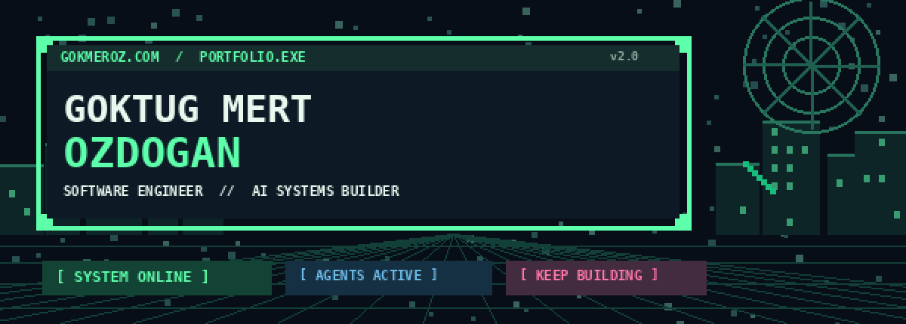
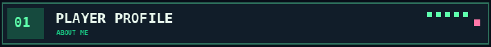
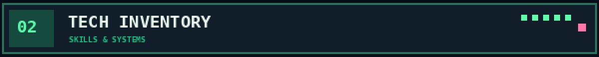
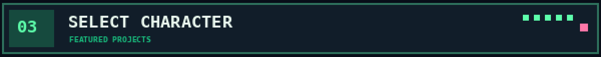
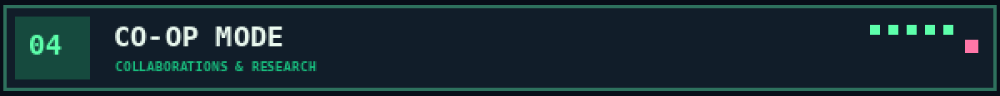
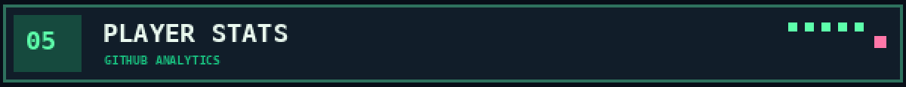
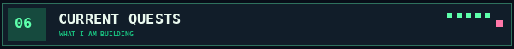
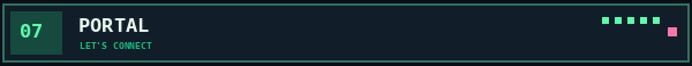

**Software Engineer** building backend-driven products, AI systems, and autonomous agent workflows  
Interested in **AI engineering, multi-agent systems, machine learning, fintech, and scalable software architecture**  
From designing APIs and distributed systems to building agents that **reason, execute, evaluate, and improve** their work.

[**`> ENTER PORTFOLIO`**](https://www.gokmeroz.com) · [**`> VIEW PROJECTS`**](#-featured-projects) · [**`> CONNECT`**](#-lets-connect)

## 🚀 About Me

- 🎓 Computer Engineering graduate from **Bahçeşehir University**
- 💻 Software Engineer focused on **backend engineering, full-stack development, and applied AI**
- 🔬 **AI Research Contributor at inzva AI Projects #10**, working on **ReproBot**, a multi-agent system for scientific reproducibility
- 🎨 Developing **ComArtist**, an agentic AI system designed to transform story concepts into complete comic chapters
- 🧠 Exploring **LLM agents, multimodal AI, agent orchestration, machine learning, and evaluation-driven AI systems**
- 🔧 Main stack: **Python, C#/.NET, Node.js, TypeScript, React, React Native, SQL, and MongoDB**
- 📊 Creator of **Nummoria**, an AI-powered personal finance platform tested with 1,000+ users
- 🏗️ Interested in **distributed systems, high-throughput APIs, event-driven architecture, caching, and reliable infrastructure**
- 🥋 Into **MMA, football, comics, finance, and building useful things**
- 💛 Die-hard **Fenerbahçe** fan

## 🛠️ Tech Stack

**`01 / LANGUAGES & BACKEND`**  
`Python` • `C#` • `.NET` • `ASP.NET Core` • `Node.js` • `Express.js` • `Java` • `FastAPI` • `REST APIs`

**`02 / FRONTEND & MOBILE`**  
`React` • `React Native` • `Angular` • `TypeScript` • `JavaScript` • `Tailwind CSS` • `Streamlit`

**`03 / DATABASES & MESSAGING`**  
`SQL Server` • `MongoDB` • `PostgreSQL` • `Mongoose` • `Redis` • `RabbitMQ` • `BullMQ`

**`04 / AI, ML & AGENTS`**  
`PyTorch` • `Hugging Face` • `LangGraph` • `LangChain` • `scikit-learn` • `Pandas` • `NumPy` • `XGBoost` • `LLM Agents` • `Multi-Agent Orchestration` • `Vision-Language Models` • `RAG` • `Recommendation Systems` • `Structured Extraction` • `LLM-as-a-Judge`

**`05 / TOOLS & PLATFORMS`**  
`Git` • `GitHub` • `Docker` • `AWS` • `Azure` • `Linux` • `CI/CD` • `Vercel` • `Railway` • `Postman` • `Swagger` • `uv`

## 📌 Featured Projects

### 🔬 [ReproBot — Agentic AI for Scientific Reproducibility](https://github.com/EngincanVaran/ReproBot)

**AI Research Contributor · inzva AI Projects #10**  
`RESEARCH QUEST` · `MULTI-AGENT SYSTEM` · `IN PROGRESS`

A multi-agent research system designed to reproduce and validate machine-learning experiments from scientific publications.

ReproBot coordinates four specialized agents through an orchestrated workflow:

- **Reader Agent:** Analyzes research papers, extracts experimental configurations, and produces structured specifications using document-processing tools, LLMs, and vision-language models.
- **Coder Agent:** Translates extracted methodologies into executable machine-learning experiments.
- **Runner Agent:** Executes experiments in isolated Docker environments and collects logs, metrics, and artifacts.
- **Critic Agent:** Evaluates experimental results against published claims, identifies reproducibility gaps, and provides feedback for iterative refinement.

**Current focus:** Critic–Coder feedback loops, claim verification, reproducibility evaluation, and improving the reliability of agent-generated experiments.

**Technologies:** `Python` `LangGraph` `LangChain` `Docker` `PyTorch` `Hugging Face` `LLMs` `VLMs` `Structured Extraction`

---

### 🎭 ComArtist — Agentic AI Comic Generation

**Independent Project · In Development**  
`CREATIVE QUEST` · `MULTIMODAL AI` · `IN DEVELOPMENT`

An ambitious multi-agent AI system designed to transform a high-level story idea into a complete, visually coherent comic chapter.

Rather than treating comic generation as a single image-generation task, ComArtist approaches it as an **autonomous creative production workflow**, inspired by the specialized roles involved in professional comic publishing.

The planned architecture includes:

- **Story & Narrative Agents:** Develop plots, character arcs, dialogue, and narrative structure.
- **Script & Panel Planning Agents:** Translate stories into panel-by-panel scripts, layouts, compositions, and visual directions.
- **Visual Generation Agents:** Generate comic artwork while maintaining character identities, stylistic consistency, and scene continuity.
- **Critic & Revision Agents:** Use multimodal evaluation to identify narrative and visual inconsistencies and guide iterative improvements.
- **Lettering & Layout Agents:** Assemble dialogue, speech balloons, artwork, and panel arrangements into comic pages.
- **Continuity & Evaluation Systems:** Maintain persistent lore and character context while assessing chapter-level coherence and quality.

**Engineering focus:** Multi-agent orchestration, multimodal reasoning, long-term memory, structured inter-agent communication, iterative refinement, and autonomous quality evaluation.

**Planned technologies:** `Python` `LangGraph` `Hugging Face` `LLMs` `Vision-Language Models` `Image Generation` `Streamlit`

*The goal: an AI-powered comic production pipeline where specialized agents collaborate like a creative team.*

---

### ❇️ [Nummoria — AI-Powered Personal Finance](https://github.com/gokmeroz/nummoria)

**Independent Project · [Live Platform](https://nummoria.com)**  
`FINTECH QUEST` · `FULL-STACK` · `LIVE PLATFORM`

Designed and developed a full-stack personal finance platform that transforms financial activity into personalized, actionable insights.

- Built web and mobile experiences with React and React Native.
- Developed backend APIs and authentication workflows using Node.js and MongoDB.
- Integrated AI-powered financial assistance and receipt-processing capabilities.
- Implemented background processing and asynchronous workflows using Redis and BullMQ.
- Tested the platform with **more than 1,000 users**.
- Exploring a stronger ML-driven foundation for transaction understanding, categorization, and financial behavior modeling.

**Technologies:** `Node.js` `Express.js` `React` `React Native` `MongoDB` `Redis` `BullMQ` `LLM APIs`

---

### 🕸️ [Spider-Man Comics Recommender](https://github.com/gokmeroz/spiderman-comics-recommender)

`MACHINE LEARNING QUEST` · `SPIDER-VERSE`

A machine-learning recommendation project exploring content-based filtering, user preference modeling, similarity scoring, and hybrid ranking approaches across Spider-Man comics.

**Focus:** Recommendation systems, feature engineering, information retrieval, and personalized ranking.

---

### 🤖 [JobPilot — Autopilot for Job Applications](https://github.com/gokmeroz/jobpilot-autopilot-for-job-applications)

`AUTOMATION QUEST` · `API INTEGRATION`

An automated job-discovery pipeline designed to collect recently published roles, evaluate resume compatibility, apply eligibility filters, track applications, and generate structured reports.

**Focus:** Workflow automation, API integration, data processing, and job-matching logic.

---

### ⚡ [RepoPulse](https://github.com/gokmeroz/RepoPulse)

`BACKEND QUEST` · `EVENT-DRIVEN`

An open-source, event-driven GitHub repository recommender that analyzes developers' interests and learning goals.

**Technologies:** `FastAPI` `RabbitMQ` `Docker` `PostgreSQL` `NumPy` `PyTorch`

## 🤝 Collaborations & Research

### 🔬 [ReproBot — inzva AI Projects #10](https://github.com/EngincanVaran/ReproBot)

**AI Research Contributor**

Collaborating on research into agentic scientific reproducibility, including paper interpretation, structured methodology extraction, automated experiment execution, and evaluation against published results.

The project explores the challenges of building AI systems that do more than generate plausible outputs: they must execute experiments, inspect evidence, identify failures, and iteratively improve their solutions.

### 👁️ [Eyehub — Dyslexia Detection Mobile Application](https://github.com/eyehub2/eyehub_web)

**Backend Developer · TÜBİTAK Project 122E085**

Contributed to the backend of a research-based mobile application developed to support dyslexia detection in children.

Built server-side functionality, database integrations, and cloud components using Node.js, JavaScript, MongoDB, AWS EC2, and AWS Lambda as part of an interdisciplinary research team.

## 📈 GitHub Analytics

  
  

## 🌱 Currently Focused On

- 🔬 **ReproBot:** Developing and refining agentic scientific reproducibility workflows, with an emphasis on evaluation, verification, and Critic–Coder iteration.
- 🎭 **ComArtist:** Designing a multimodal agent architecture for autonomous comic production, creative collaboration, and visual consistency.
- 🧠 **AI/ML:** Deepening knowledge of neural networks, transformers, LLM systems, and practical machine-learning engineering.
- ⚙️ **Backend Engineering:** Designing maintainable APIs, distributed workflows, scalable data models, and event-driven systems.
- 📊 **Nummoria:** Exploring ML-based transaction understanding, intelligent categorization, and personalized financial insights.
- 🐳 **Infrastructure:** Strengthening Docker, cloud deployment, observability, CI/CD, and production reliability skills.
- 📈 **Computer Science:** Consistently practicing data structures, algorithms, and system design.

## 💬 Let's Connect

- 💼 [LinkedIn](https://www.linkedin.com/in/goktugmertozdogan)
- 📧 **[goekmeroz@gmail.com](mailto:goekmeroz@gmail.com)**
- 🐦 [X](https://x.com/gokmeroz_dev)
- 🌍 **[gokmeroz.com](https://www.gokmeroz.com)**

`[ GAME STATUS: GRINDING ]` · `PRESS START TO BUILD`

